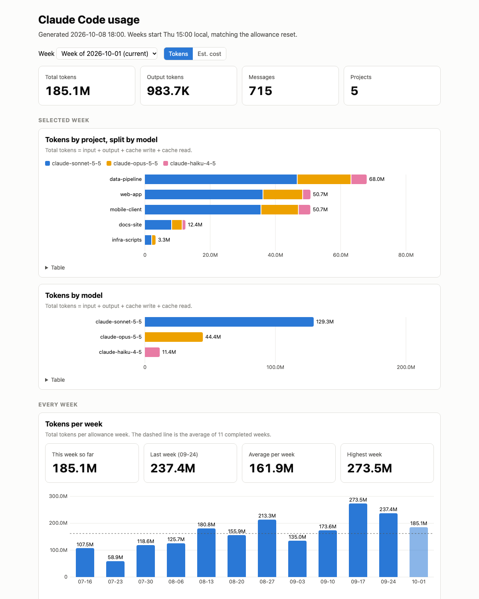

# claude-usage

Track your own Claude Code token usage week by week, built from the local transcripts in `~/.claude/projects`. Everything stays on your machine: this repo is just the tool, and your data is git-ignored.

<picture>
  <source media="(prefers-color-scheme: dark)" srcset="docs/img/portal-dark.png">
  
</picture>

_The report above is built from synthetic data, not real usage. Open [examples/report.html](examples/report.html) to try it, or regenerate it with `python3 demo.py`._

Outputs, written to `data/` (git-ignored):

- `data/report.html`: charts by project and model for any week, plus weekly totals by project and by model, in estimated cost or tokens
- `data/WEEKLY.md`: weekly totals, plus a by-model and by-project breakdown for the last two weeks
- `data/daily.csv`: the durable record, one row per date × allowance week × project × model
- `data/weekly.csv`: weekly rollup by model

Claude Code deletes transcripts after about 30 days, so `daily.csv` keeps the history. Each run merges new numbers into it by taking the larger value per row, so pruned transcripts never remove data. Run it at least every few weeks or older days will be lost before they're recorded.

## Setup

See the [setup guide](docs/SETUP.md) (and [SLACK.md](docs/SLACK.md) for an optional weekly DM to yourself), or open this repo in Claude Code and ask it to help you set up (see [CLAUDE.md](CLAUDE.md)).

## Usage

```bash
python3 collect.py      # collect and rebuild reports
./update.sh             # same, plus optional commit/push of your data (see below)
./install-schedule.sh   # run update.sh weekly via launchd, 5 minutes before the allowance reset
```

Requires only Python 3 (stdlib). Token counts come straight from the API `usage` fields; streamed messages are de-duplicated by message and request ID.

## Configuration

Set these as environment variables (all optional):

| Variable | Default | Meaning |
|---|---|---|
| `CLAUDE_USAGE_RESET_DAY` | `thu` | Weekday your weekly allowance resets (`mon`..`sun`) |
| `CLAUDE_USAGE_RESET_HOUR` | `15` | Hour of that reset, 0-23 local time |
| `CLAUDE_USAGE_DATA_DIR` | `./data` | Where CSVs and reports are written |
| `CLAUDE_USAGE_PUSH` | unset | Set to `1` to have `update.sh` commit and push the data directory |
| `CLAUDE_CONFIG_DIR` | `~/.claude` | Where Claude Code keeps transcripts |

Weeks run from the reset time to the next reset. Set these before your first run. If you change them later, days still covered by transcripts (about 30 days) are re-bucketed under the new reset; older rows in `daily.csv` keep the week they were originally assigned.

```bash
CLAUDE_USAGE_RESET_DAY=mon CLAUDE_USAGE_RESET_HOUR=9 ./install-schedule.sh
```

## Pushing your data (opt-in)

By default nothing is committed or pushed, and `data/` is in `.gitignore`. To back up or share your data, make the data directory its own private repo:

```bash
cd data && git init && git remote add origin <your-private-repo-url> && cd ..
CLAUDE_USAGE_PUSH=1 ./update.sh
```

`update.sh` refuses to push unless the data directory is its own git repo, so your data can never land in this tool repo by accident. Set `CLAUDE_USAGE_PUSH=1` before running `install-schedule.sh` to make the scheduled run push too.

## Cost estimate and the price table

Estimated cost uses Anthropic API list prices, with cache writes at 1.25x input for the 5-minute TTL and 2x for the 1-hour TTL. It's what the usage would cost on the API, not what a subscription bills.

Prices live in the `PRICES` table at the top of `report.py`, as `model ID: (input, output, cache read)` in dollars per million tokens. Dated IDs like `claude-haiku-4-5-20251001` match their undated entry. When a new model ships, add one line and rerun `collect.py`. A model with no entry is counted as $0 and named in a note at the bottom of `report.html`, so a missing price never breaks the run, but your cost totals will be low until you add it.

## Development

```bash
python3 -m unittest discover   # tests use synthetic transcripts only
python3 demo.py                # regenerate the synthetic example in examples/
```

## License

MIT, see [LICENSE](LICENSE).
